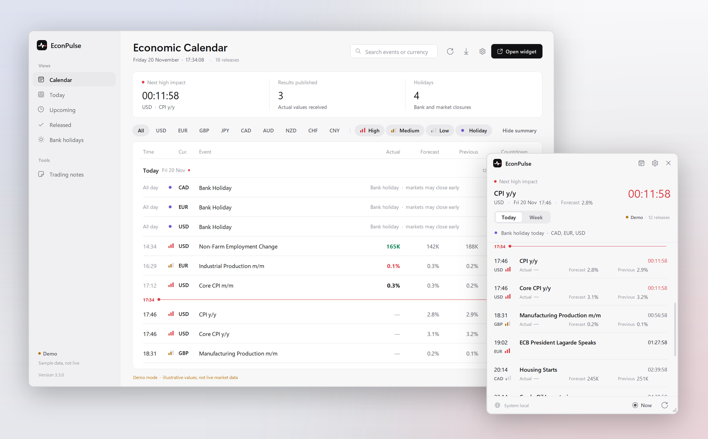
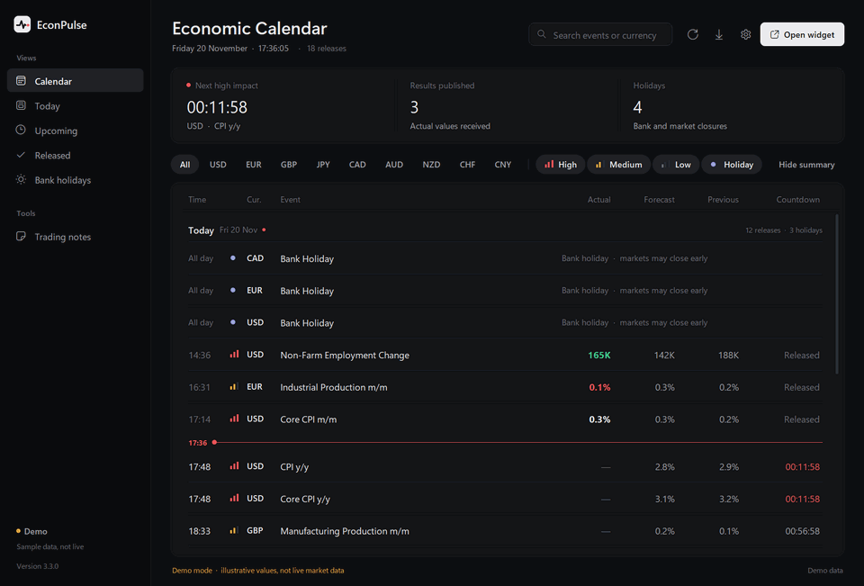
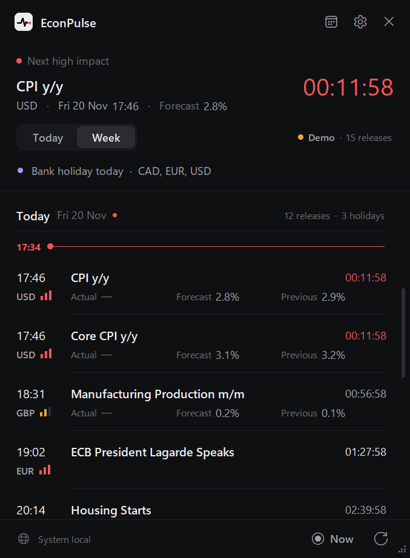
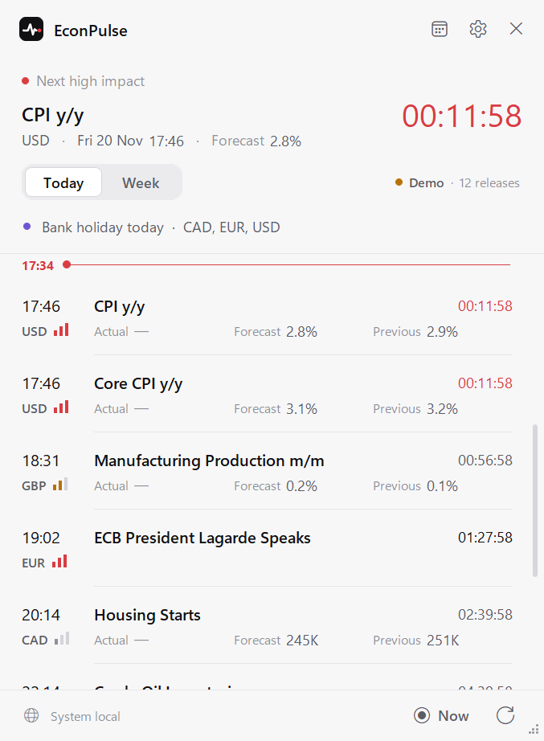
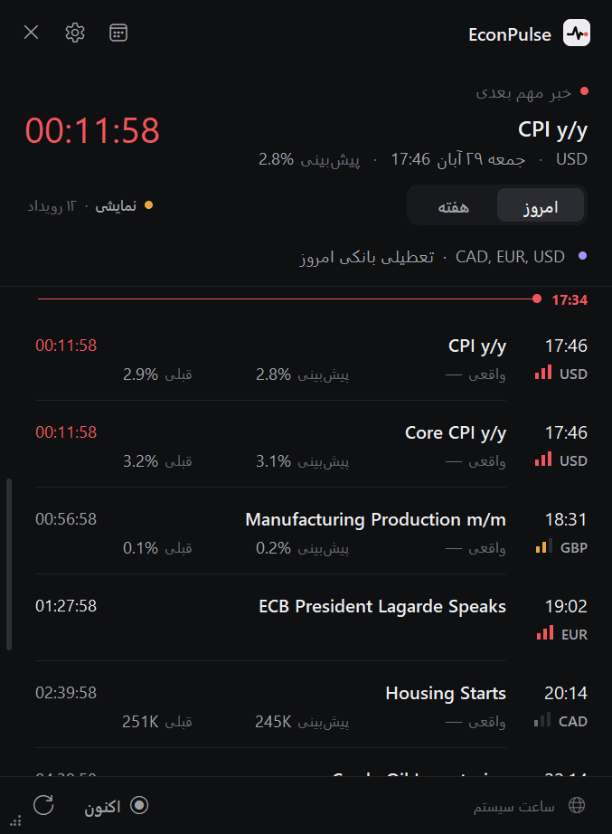
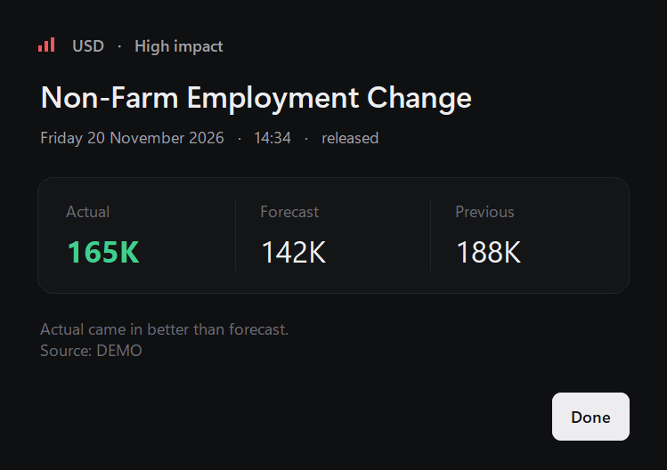
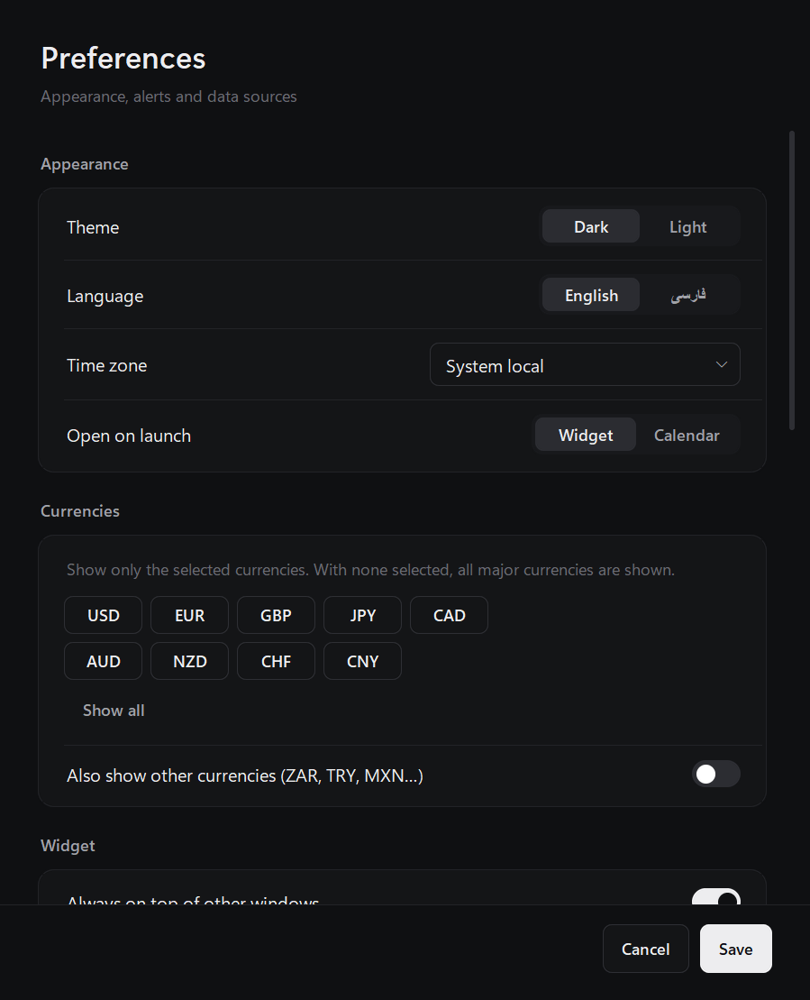
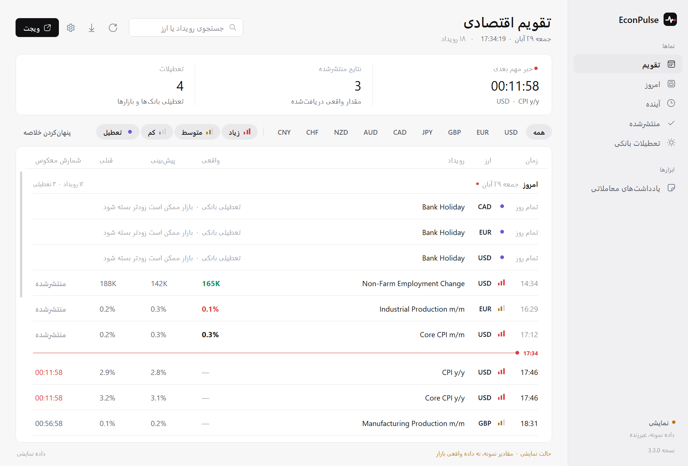
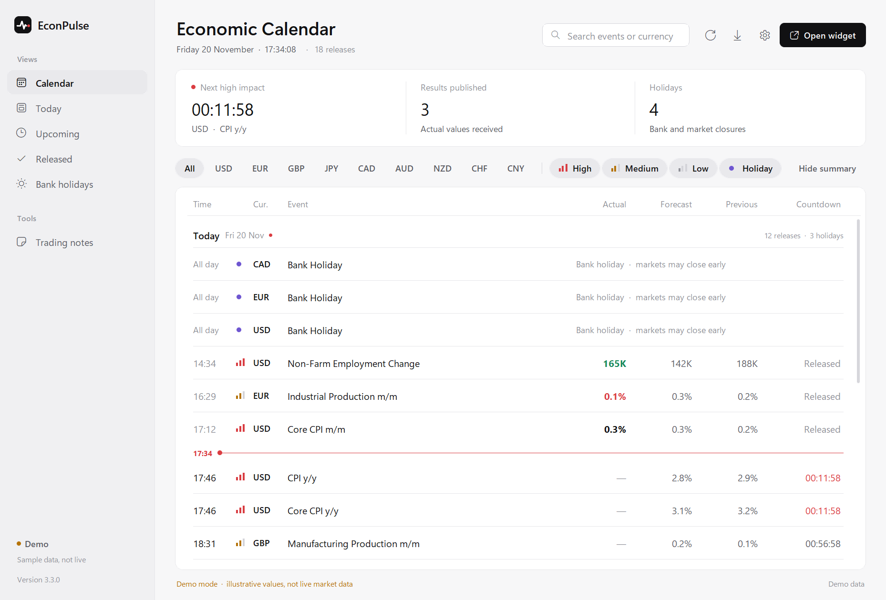

<a id="readme-top"></a>

<div align="center">


<h1>EconPulse</h1>

<p><strong>The economic calendar that lives on your desktop.</strong></p>

<p>A floating widget counts down to the next high-impact release. The full calendar shows the week with<br>Actual, Forecast and Previous values, alerts, filters and exports. Free, open source and private.</p>

<p>
<a href="https://github.com/Kasra-Sartaee/econpulse/releases/latest"></a>
<a href="https://github.com/Kasra-Sartaee/econpulse/releases"></a>
<a href="https://github.com/Kasra-Sartaee/econpulse/actions/workflows/ci.yml"></a>
<a href="https://github.com/Kasra-Sartaee/econpulse/actions/workflows/codeql.yml"></a>
<a href="https://scorecard.dev/viewer/?uri=github.com/Kasra-Sartaee/econpulse"></a>
<a href="https://www.bestpractices.dev/projects/16977"></a>
</p>

<p>
<a href="LICENSE"></a>


<a href="README_FA.md"></a>
<a href="https://github.com/astral-sh/ruff"></a>
<a href="CONTRIBUTING.md"></a>
</p>

<p>
<a href="https://github.com/Kasra-Sartaee/econpulse/releases/latest"><strong>Download</strong></a> ·
<a href="https://kasra-sartaee.github.io/econpulse/">Website</a> ·
<a href="#features">Features</a> ·
<a href="#data-sources">Data sources</a> ·
<a href="#faq">FAQ</a> ·
<a href="CONTRIBUTING.md">Contributing</a> ·
<a href="README_FA.md">فارسی</a>
</p>

<picture>
  <source media="(prefers-color-scheme: dark)" srcset="docs/assets/hero-dark.png">
  
</picture>

</div>

## Contents

- [Why EconPulse](#why-econpulse)
- [Features](#features)
- [See it in action](#see-it-in-action)
- [Download](#download)
- [Run from source](#run-from-source)
- [Data sources](#data-sources)
- [Privacy and security](#privacy-and-security)
- [Keyboard shortcuts](#keyboard-shortcuts)
- [FAQ](#faq)
- [Roadmap](#roadmap)
- [Documentation](#documentation)
- [Contributing](#contributing)
- [Credits and licence](#credits-and-licence)

## Why EconPulse

Economic releases move markets in seconds. Calendar websites are slow, full of ads and easy to lose behind other windows. EconPulse keeps the one thing you need, **how long until the next release that matters**, always on screen, and the full week a click away.

- **Glanceable.** A compact widget stays on top of your charts with a live countdown.
- **Calm.** Alerts only for what you choose, and nothing else asks for your attention.
- **Yours.** It runs locally, with no account, ads or tracking, and it's MIT-licensed.

## Features

<table>
<tr>
<td width="50%" valign="top">

**Floating widget**<br>
Countdown to the next high-impact release, then today's or this week's schedule with a red line at the current time. Stays on top, can be dragged and resized, and reopens on the monitor you left it on.

</td>
<td width="50%" valign="top">

**Full calendar**<br>
Calendar, Today, Upcoming, Released and Bank holidays views, with search, currency and impact filters, and a summary of the next release, results published and holidays.

</td>
</tr>
<tr>
<td valign="top">

**Actual · Forecast · Previous**<br>
Values for every release as they're published, how far the Actual landed from the forecast (for example *+23K* or *−0.1 pp*), revisions to the previous figure, the indicator's recent releases, live countdowns, and a link to the original source.

</td>
<td valign="top">

**Alerts**<br>
Desktop notifications 30, 15 and 5 minutes before high-impact releases and as they're published, plus a *Result published* alert when the figure arrives. Each one is optional, fires once even across restarts, and the sound stays quiet during Focus Assist and full-screen apps.

</td>
</tr>
<tr>
<td valign="top">

**Watchlist and notes**<br>
Star any indicator to get its alerts whatever its impact, and keep a private note on it that carries over to next month's release. A compact ticker bar (<kbd>Ctrl</kbd>+<kbd>M</kbd>) can be docked along the top or bottom of the screen like the taskbar, showing the next releases side by side, and <kbd>Ctrl</kbd>+<kbd>Alt</kbd>+<kbd>E</kbd> brings the widget up from anywhere (optional).

</td>
<td valign="top">

**Export**<br>
Save the current view to CSV for spreadsheets (safe to open in Excel) or ICS for calendar apps. An optional `next.json` file feeds [OBS, Stream Deck or your own scripts](docs/OBS.md).

</td>
</tr>
<tr>
<td valign="top">

**Accessible**<br>
A high-contrast theme (used automatically when Windows' contrast themes are on), text at 100, 115 or 130 %, full keyboard control with visible focus, and impact shown by shape as well as colour.

</td>
<td valign="top">

**English and Persian**<br>
Persian mirrors the entire layout right to left and shows Solar Hijri dates. Adding another language takes [one file](docs/TRANSLATING.md).

</td>
</tr>
<tr>
<td valign="top">

**Polished everywhere**<br>
Dark, light and high-contrast themes, sharp on high-DPI screens, 18 trading time zones, a system-tray menu, start at login, and private trading notes.

</td>
<td valign="top">

**Fast**<br>
Starts in about a quarter of a second. Lists draw only the visible rows, and the per-second countdown never redraws the layout.

</td>
</tr>
</table>

## See it in action

<div align="center">

</div>

<table>
<tr>
<td width="33%" align="center"><br><sub>The week at a glance</sub></td>
<td width="33%" align="center"><br><sub>Light theme</sub></td>
<td width="33%" align="center"><br><sub>Right-to-left Persian</sub></td>
</tr>
</table>

<details>
<summary><strong>More screenshots</strong></summary>
<br>

| Release details | Preferences |
|---|---|
|  |  |





</details>

<sub>All screenshots use the built-in demo data (`--demo`), not live market data.</sub>

## Download

| Platform | How | Status |
|---|---|---|
| **Windows 10 and 11** (64-bit) | [Download the latest release](https://github.com/Kasra-Sartaee/econpulse/releases/latest) | Supported |
| macOS | [Run from source](#run-from-source) | Experimental |
| Linux | [Run from source](#run-from-source) | Experimental |

From the [latest release](https://github.com/Kasra-Sartaee/econpulse/releases/latest), take either:

- **`EconPulse-<version>-Setup.exe`** (recommended): installs for your account only, with no admin rights, adds a Start-menu entry and an uninstaller, and **updates itself**. When a new version is out (with *Tell me when a new version is out* on in Settings), one click downloads it, checks it and installs it.
- **`EconPulse-<version>-Windows.zip`**: the portable app. Unzip it anywhere and run `EconPulse\EconPulse.exe`, keeping the `_internal` folder next to it. It tells you about new versions but never replaces itself.

No Python needed either way, and your settings and notes are kept across updates and uninstalls.

The app isn't code-signed yet, so Windows SmartScreen may warn the first time: choose **More info → Run anyway**.

<details>
<summary><strong>Verify your download</strong> (optional)</summary>
<br>

Every release is built by GitHub Actions from this repository with hash-pinned tools. Each release includes:

- `SHA256SUMS.txt`: checksums of the installer, the zip and the SBOM. In PowerShell: `Get-FileHash EconPulse-<version>-Setup.exe`
- `EconPulse-<version>-SBOM.cdx.json`: a CycloneDX software bill of materials listing every package in the build
- `EconPulse-<version>.sigstore.json`: signed build provenance

With the [GitHub CLI](https://cli.github.com/), this proves a file was built here, from a specific commit:

```sh
gh attestation verify EconPulse-<version>-Setup.exe --repo Kasra-Sartaee/econpulse
```

The in-app updater makes the same kind of check before it runs anything: the installer must match the release's `SHA256SUMS.txt`, and GitHub must hold a build attestation for it from this repository.

</details>

## Run from source

You need Python 3.11 or newer with Tk. It's included in the python.org installers; on Debian and Ubuntu, install `python3-tk`.

```sh
git clone https://github.com/Kasra-Sartaee/econpulse.git
cd econpulse
python -m pip install -r requirements.txt
python -m econpulse             # or: python main.py
python -m econpulse --demo      # sample data, no network
```

On Windows you can also double-click `RUN_WINDOWS.bat` (the first run installs the hash-checked packages into a private `.venv` folder, leaving your own Python untouched) or `DEMO_WINDOWS.bat`. On Linux and macOS, `./run.sh` creates a virtual environment and starts the app.

<details>
<summary><strong>Notes for macOS and Linux</strong></summary>
<br>

The tests run on both in CI, but the app is mainly used on Windows.

- **Persian right-to-left text needs Windows**, because Tk on Linux can't shape Arabic-script text.
- **The tray icon on Linux** needs a desktop with AppIndicator or XEmbed support. Without it, closing the window quits the app and alerts appear inside the app.
- **Start at login** uses an XDG autostart entry on Linux and a LaunchAgent on macOS.

</details>

<details>
<summary><strong>Build the Windows app yourself</strong></summary>
<br>

Double-click `BUILD_WINDOWS.bat`. It creates a private virtual environment from the hash-locked `requirements-build.lock`, runs the tests, and writes `dist\EconPulse\EconPulse.exe` and `dist\EconPulse-<version>-Windows.zip`. The official releases use the same script (`tools/build_windows.py`).

</details>

## Data sources

EconPulse has no server. Your computer fetches the calendar directly, at most every 15 minutes, and backs off (30, then 60, then 120 minutes) after errors or when a source asks it to wait. Only yesterday to tomorrow can change during the day, so that is all it downloads between hourly refreshes of the full three weeks: about 6 small requests an hour. If you turn on *Fast check after high-impact releases* (off by default), it also checks 45 seconds and 3 minutes after a watched release time, while that release's Actual value is still missing.

| Source | What it provides | Setup |
|---|---|---|
| [biquote](https://biquote.io/) **(default)** | Schedule, impact, Actual, Forecast and Previous for about 50 countries | None. Free for commercial and non-commercial use under its [terms](https://biquote.io/terms.html) |
| Forex Factory official weekly export | This week's schedule, impact, Forecast and Previous (**no Actual values**) | None. Also used automatically when the selected source is unavailable |
| [FinanceCalendar.com](https://www.financecalendar.com/api/) | Data from official statistics agencies with Actual, consensus and prior values | Your own API key (Settings → Data source). The free plan has no figures; 15-minute refreshes need a paid plan. Its [terms](https://www.financecalendar.com/api/terms/) require the attribution shown in the app |

EconPulse doesn't read forexfactory.com web pages; their terms of service don't allow automated access. EconPulse isn't affiliated with any data provider.

> [!IMPORTANT]
> **Nothing in this app is financial advice.** Data can be late, revised or wrong. Check important figures at the source before acting on them.

Want another source? See [docs/PROVIDERS.md](docs/PROVIDERS.md).

## Privacy and security

- **No account, no telemetry, no analytics.**
- **Network requests** go only to your data source (plus the Forex Factory export as a fallback). They also go to GitHub once a day if you switch on **Tell me when a new version is out**, which is off by default. Requests identify the app as `EconPulse/<version>` and send nothing about you.
- **Everything stays local** in your data folder: `%APPDATA%\EconPulse` on Windows, `~/Library/Application Support/EconPulse` on macOS, `~/.config/EconPulse` on Linux. That covers settings (an optional API key is encrypted for your Windows account, or kept in the macOS Keychain or Linux Secret Service when the `keyring` package is installed), cached calendar data, a record of past releases, alert history, trading notes and per-indicator notes (plain text), an optional `next.json` status file and a small log. **Settings → About → Open data folder** takes you there.
- **Hardened input handling.** Everything is fetched over HTTPS only, with size-capped responses, length-limited fields and validated settings. Links open only if they're `https://`, and CSV exports are protected against spreadsheet formula injection.
- **Continuously checked** by [CodeQL](https://codeql.github.com/), [Bandit](https://bandit.readthedocs.io/), [pip-audit](https://pypi.org/project/pip-audit/), [OpenSSF Scorecard](https://scorecard.dev/) and Dependabot. The code that reads downloaded data is [fuzzed](fuzz/fuzz_calendar_data.py) with [Atheris](https://github.com/google/atheris) on every change. All GitHub Actions and dependencies are pinned to hashes.
- **Recognised good practice:** EconPulse holds the [OpenSSF Best Practices](https://www.bestpractices.dev/projects/16977) passing badge.

Found a vulnerability? Please report it privately; see [SECURITY.md](SECURITY.md).

## Keyboard shortcuts

| Key | Action |
|---|---|
| <kbd>Ctrl</kbd>+<kbd>F</kbd> | Search (full calendar) |
| <kbd>Ctrl</kbd>+<kbd>1</kbd>–<kbd>5</kbd> | Switch calendar views |
| <kbd>Ctrl</kbd>+<kbd>W</kbd> | Switch to the floating widget |
| <kbd>Ctrl</kbd>+<kbd>M</kbd> | Toggle compact ticker-bar widget mode |
| <kbd>Ctrl</kbd>+<kbd>,</kbd> | Open Preferences |
| <kbd>Ctrl</kbd>+<kbd>E</kbd> | Export current view |
| <kbd>Ctrl</kbd>+<kbd>N</kbd> | Open trading notes |
| <kbd>F5</kbd> | Refresh |
| <kbd>Esc</kbd> | Clear the search, or switch from the calendar to the widget |
| <kbd>↑</kbd> <kbd>↓</kbd> <kbd>Page Up</kbd> <kbd>Page Down</kbd> <kbd>Home</kbd> <kbd>End</kbd> | Scroll the list (click the list first) |
| <kbd>Enter</kbd> / <kbd>Esc</kbd> | Close the details window |
| <kbd>Ctrl</kbd>+<kbd>S</kbd> | Save trading notes |

## FAQ

<details>
<summary><strong>Is it really free?</strong></summary>
<br>
Yes. EconPulse is MIT-licensed open source, with no ads, subscriptions or account. The default data source is free too. Only the optional FinanceCalendar.com source needs a (paid) key of your own.
</details>

<details>
<summary><strong>Why aren't Actual values green or red?</strong></summary>
<br>
Whether a number is "good" depends on the indicator: higher GDP is usually good, higher unemployment isn't. The default source doesn't say whether a result beat expectations, so EconPulse shows Actual values in a neutral colour rather than guess. When a source does provide that signal, EconPulse colours the value.
</details>

<details>
<summary><strong>Why doesn't EconPulse use the Forex Factory website?</strong></summary>
<br>
Their terms of service don't allow automated access to the site. EconPulse uses Forex Factory's official weekly export instead, which they publish for this purpose. It has no Actual values, so it serves as the fallback.
</details>

<details>
<summary><strong>Windows says the app is unrecognised. Is it safe?</strong></summary>
<br>
SmartScreen warns about any app that isn't code-signed, and certificates cost money we haven't spent yet. Every release is built publicly by GitHub Actions from this source code, with checksums and signed build provenance you can <a href="#download">verify</a>.
</details>

<details>
<summary><strong>Does it work offline?</strong></summary>
<br>
Yes. EconPulse shows the last calendar it downloaded, marked as cached, and alerts still fire from it. It refreshes automatically when you're back online.
</details>

<details>
<summary><strong>A number looks wrong.</strong></summary>
<br>
EconPulse shows what its source publishes, and early figures are often revised. Open the release (click it) and use <em>Open source page</em> to compare. If the source is right and EconPulse is wrong, please <a href="https://github.com/Kasra-Sartaee/econpulse/issues/new/choose">open a bug report</a>.
</details>

<details>
<summary><strong>How do I uninstall it?</strong></summary>
<br>
Turn off <em>Start automatically at login</em> in Settings, quit EconPulse from the tray icon, and delete its folder. To remove your settings and notes too, delete the data folder listed under <a href="#privacy-and-security">Privacy and security</a>.
</details>

<details>
<summary><strong>Can I add my language or a data source?</strong></summary>
<br>
Please do! A language is one file (<a href="docs/TRANSLATING.md">guide</a>), and a data source is one module behind a small interface (<a href="docs/PROVIDERS.md">guide</a>).
</details>

## Roadmap

These are ideas, not promises. [Open an issue](https://github.com/Kasra-Sartaee/econpulse/issues/new/choose) to discuss one or to pick it up.

- [ ] Code-signed Windows builds, so SmartScreen stops warning
- [x] An installer that updates itself, with verified downloads
- [ ] `winget install EconPulse` (the manifests are generated by `tools/winget_manifest.py`; the first submission is pending)
- [ ] `pipx install econpulse` from PyPI (the publishing workflow is ready; it needs a one-time PyPI setup)
- [ ] Packaged builds for macOS and Linux
- [ ] More languages: Arabic, Turkish, Spanish, Chinese… (help wanted)
- [ ] More data sources with open terms, and comparing two sources when both are available
- [ ] Per-indicator alert rules and quiet hours
- [x] Indicator history: an indicator's recent releases against their forecasts
- [ ] Screen-reader support (needs a UI toolkit with accessibility support; see [ARCHITECTURE.md](docs/ARCHITECTURE.md))

## Documentation

| Document | For |
|---|---|
| [CONTRIBUTING.md](CONTRIBUTING.md) | Setting up, coding style, tests and pull requests |
| [docs/ARCHITECTURE.md](docs/ARCHITECTURE.md) | How the app fits together, with diagrams |
| [docs/PROVIDERS.md](docs/PROVIDERS.md) | Adding a data source |
| [docs/TRANSLATING.md](docs/TRANSLATING.md) | Adding a language |
| [SECURITY.md](SECURITY.md) | Reporting vulnerabilities; what the app stores and connects to |
| [docs/OBS.md](docs/OBS.md) | Showing the next release in OBS, Stream Deck or a script |
| [docs/RELEASING.md](docs/RELEASING.md) | Making a release (maintainers) |
| [GOVERNANCE.md](GOVERNANCE.md) | Who decides, and how changes are reviewed |
| [SUPPORT.md](SUPPORT.md) | Getting help |
| [CHANGELOG.md](CHANGELOG.md) | What changed in each version |

## Contributing

Bug reports, translations, data sources and code are all welcome. Start with [CONTRIBUTING.md](CONTRIBUTING.md), and please follow the [Code of Conduct](CODE_OF_CONDUCT.md). Good first steps are adding a language or improving the experimental macOS and Linux support.

## Credits and licence

Created and maintained by **Aref Hosseini** and **[Kasra Sartaee](https://github.com/Kasra-Sartaee)**. The original idea came from [Economic Calendar by Bilenay](https://github.com/zekibilenay/economic-calendar) (MIT). Calendar data comes from [biquote](https://biquote.io/), Forex Factory's public export and, optionally, [FinanceCalendar.com](https://www.financecalendar.com/).

Released under the [MIT licence](LICENSE). If you use EconPulse in research, GitHub's **Cite this repository** button gives a ready-made citation.

<p align="right"><a href="#readme-top">Back to top ↑</a></p>
