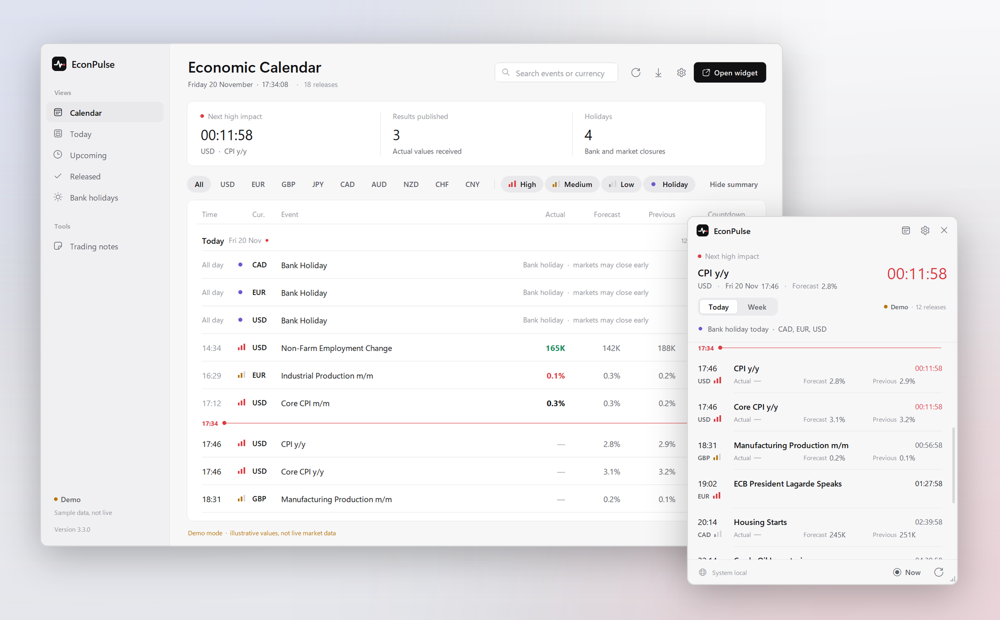
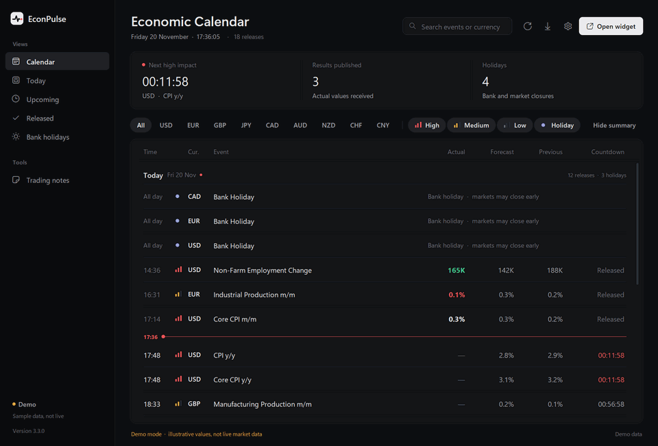
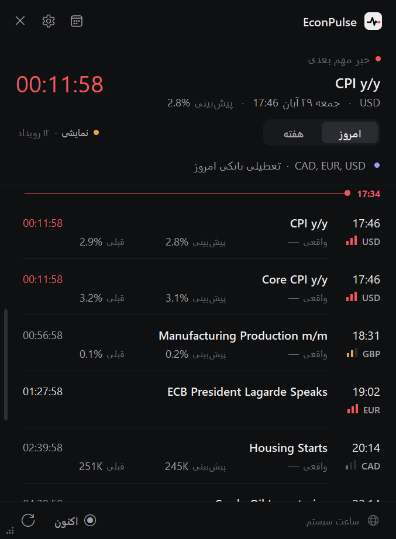
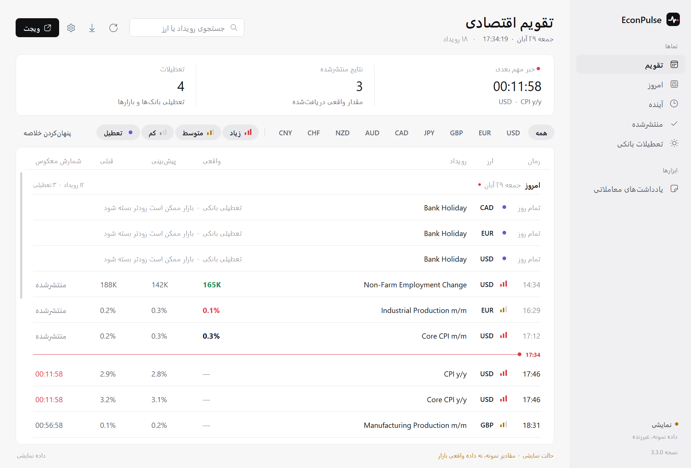

<div align="center">


<h1>EconPulse</h1>

<p dir="rtl"><strong>تقویم اقتصادی که روی دسکتاپ شما زندگی می‌کند.</strong></p>

<p>
<a href="https://github.com/Kasra-Sartaee/econpulse/releases/latest"></a>
<a href="https://github.com/Kasra-Sartaee/econpulse/actions/workflows/ci.yml"></a>
<a href="LICENSE"></a>

<a href="README.md"></a>
</p>

<p dir="rtl">
<a href="https://github.com/Kasra-Sartaee/econpulse/releases/latest"><strong>دریافت</strong></a> ·
<a href="https://kasra-sartaee.github.io/econpulse/">وب‌سایت</a> ·
<a href="README.md">English</a>
</p>

<picture>
  <source media="(prefers-color-scheme: dark)" srcset="docs/assets/hero-dark.png">
  
</picture>

</div>

<div dir="rtl">

**تقویم اقتصادی برای دسکتاپ شما.** یک ویجت کوچک و همیشه‌رو تا خبر مهم بعدی شمارش معکوس می‌کند و تقویم کامل، رویدادهای هفته را با مقادیر واقعی (Actual)، پیش‌بینی (Forecast) و قبلی (Previous)، هشدار، فیلتر و خروجی نشان می‌دهد. به زبان فارسی (راست‌به‌چپ، تاریخ شمسی) و انگلیسی. رایگان، متن‌باز و بدون ردیابی.

## امکانات

- **ویجت شناور:** شمارش معکوس تا خبر مهم بعدی، اخبار امروز یا این هفته و خطی که زمان فعلی را نشان می‌دهد؛ همیشه‌رو، قابل جابه‌جایی و تغییر اندازه، و روی همان مانیتور قبلی باز می‌شود.
- **تقویم کامل:** نماهای تقویم، امروز، آینده، منتشرشده و تعطیلات بانکی؛ جستجو، فیلتر ارز و اهمیت، و خلاصه خبر مهم بعدی، نتایج منتشرشده و تعطیلات.
- **مقادیر و شمارش معکوس:** واقعی، پیش‌بینی و قبلی برای هر رویداد، شمارش معکوس زنده و پنجره جزئیات.
- **هشدار:** اعلان دسکتاپ ۳۰، ۱۵ و ۵ دقیقه پیش از اخبار مهم و هنگام انتشار (هرکدام اختیاری) با صدای اختیاری.
- **خروجی** CSV (برای اکسل) و ICS (برای تقویم‌ها).
- **یادداشت‌های معاملاتی** که فقط روی رایانه شما ذخیره می‌شوند.
- **فارسی و انگلیسی:** در حالت فارسی کل چیدمان آینه‌ای و تاریخ‌ها شمسی است.
- قالب تیره و روشن، نمایش واضح در نمایشگرهای پرتراکم (HiDPI)، منوی System Tray و انتخاب منطقه زمانی.

## نمایش

</div>

<div align="center">

</div>

<table>
<tr>
<td width="50%" align="center"></td>
<td width="50%" align="center"></td>
</tr>
</table>

<div dir="rtl">

<sub>تصاویر با داده‌های نمایشی داخلی برنامه (`--demo`) تهیه شده‌اند، نه داده واقعی بازار.</sub>

## دریافت (ویندوز)

۱. فایل `EconPulse-<نسخه>-Windows.zip` را از [آخرین انتشار](https://github.com/Kasra-Sartaee/econpulse/releases/latest) دریافت کنید.

۲. آن را از حالت فشرده خارج کنید و `EconPulse\EconPulse.exe` را اجرا کنید. پوشه `_internal` باید کنار آن بماند. به نصب Python نیازی نیست.

برنامه هنوز امضای دیجیتال ندارد؛ اگر SmartScreen ویندوز در اولین اجرا هشدار داد، **More info ← Run anyway** را بزنید. هر انتشار شامل چک‌سام SHA-256 و تأییدیه ساخت GitHub است.

## اجرا از سورس

به Python نسخه ۳.۱۰ یا جدیدتر نیاز دارید (Tkinter همراه نصب‌کننده python.org هست).

<div dir="ltr">

```sh
python -m pip install -r requirements.txt
python main.py            # یا: python -m econpulse
python main.py --demo     # داده نمونه، بدون اینترنت
```

</div>

در ویندوز می‌توانید `RUN_WINDOWS.bat` یا `DEMO_WINDOWS.bat` را اجرا کنید. برای ساخت نسخه اجرایی، `BUILD_WINDOWS.bat` را اجرا کنید؛ خروجی آن `dist\EconPulse\EconPulse.exe` و فایل آماده ارسال `dist\EconPulse-<نسخه>-Windows.zip` است. پشتیبانی از لینوکس و macOS آزمایشی است و نمایش راست‌به‌چپ فارسی فقط در ویندوز کامل است.

## منابع داده

| منبع | چه چیزی می‌دهد | تنظیم |
|---|---|---|
| [biquote](https://biquote.io/) **(پیش‌فرض)** | زمان‌بندی، اهمیت، واقعی، پیش‌بینی و قبلی برای حدود ۵۰ کشور | نیازی نیست؛ طبق [شرایط آن](https://biquote.io/terms.html) برای استفاده تجاری و غیرتجاری رایگان است |
| خروجی هفتگی رسمی Forex Factory | زمان‌بندی، اهمیت، پیش‌بینی و قبلی این هفته (**بدون مقدار واقعی**) | نیازی نیست؛ اگر منبع انتخاب‌شده در دسترس نباشد، خودکار استفاده می‌شود |
| [FinanceCalendar.com](https://www.financecalendar.com/api/) | داده نهادهای رسمی آمار با واقعی، اجماع و قبلی | کلید API شخصی (تنظیمات ← منبع داده)؛ طرح رایگان ارقام ندارد |

برنامه حداکثر هر ۱۵ دقیقه داده را به‌روز می‌کند و پس از خطا یا درخواست منبع، فاصله را بیشتر می‌کند. EconPulse صفحات وب‌سایت forexfactory.com را نمی‌خواند، چون شرایط استفاده آن سایت دسترسی خودکار را مجاز نمی‌داند. این برنامه وابسته به هیچ منبع داده‌ای نیست و **توصیه مالی محسوب نمی‌شود**.

## حریم خصوصی

- بدون حساب کاربری، بدون ردیابی و بدون آمار استفاده.
- اتصال فقط به منبع داده انتخابی (و خروجی Forex Factory به‌عنوان پشتیبان) و در صورت فعال‌کردن گزینه «اطلاع از انتشار نسخه جدید»، روزی یک بار به GitHub (پیش‌فرض خاموش).
- همه چیز در پوشه داده روی رایانه شما ذخیره می‌شود: `%APPDATA%\EconPulse` در ویندوز، `~/Library/Application Support/EconPulse` در macOS و `~/.config/EconPulse` در لینوکس. تنظیمات ← درباره ← «پوشه داده‌ها» آن را باز می‌کند.
- همه درخواست‌ها فقط از طریق HTTPS انجام می‌شوند و کد برنامه به‌طور مداوم با CodeQL، Bandit، pip-audit و OpenSSF Scorecard بررسی می‌شود. برای گزارش آسیب‌پذیری امنیتی، [SECURITY.md](SECURITY.md) را ببینید.

## میان‌برها

| کلید | کار |
|---|---|
| Ctrl+F | جستجو |
| F5 | بروزرسانی |
| Esc | پاک‌کردن جستجو یا رفتن به ویجت |
| کلیدهای جهت، Page Up/Down، Home، End | پیمایش فهرست (ابتدا روی فهرست کلیک کنید) |
| Ctrl+S | ذخیره یادداشت‌ها |

## مشارکت

گزارش اشکال، ترجمه، منبع داده جدید و کد همه خوش‌آمدند. راهنما: [CONTRIBUTING.md](CONTRIBUTING.md)، معماری برنامه: [docs/ARCHITECTURE.md](docs/ARCHITECTURE.md) و برای افزودن زبان: [docs/TRANSLATING.md](docs/TRANSLATING.md). برای گزارش اشکال، متن «کپی اطلاعات عیب‌یابی» را از تنظیمات ← درباره ضمیمه کنید.

## سازندگان و مجوز

ساخته **Aref Hosseini** و **Kasra Sartaee**. ایده اولیه از [Economic Calendar by Bilenay](https://github.com/zekibilenay/economic-calendar) (مجوز MIT) گرفته شده است. منتشرشده با [مجوز MIT](LICENSE). نسخه انگلیسی: [README.md](README.md). تغییرات: [CHANGELOG_FA.md](CHANGELOG_FA.md).

</div>
