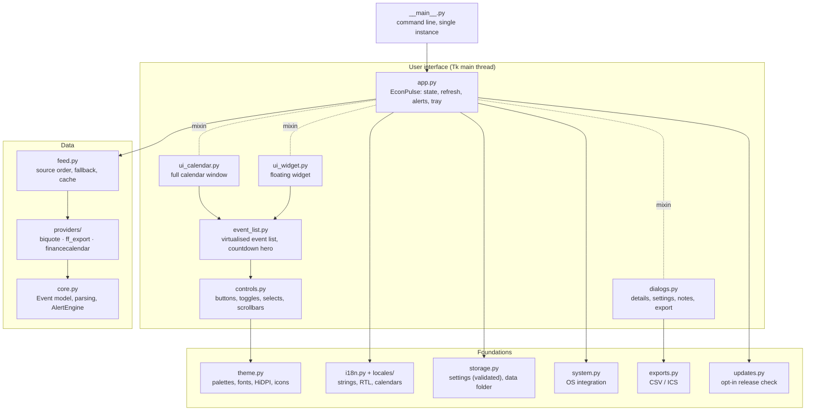
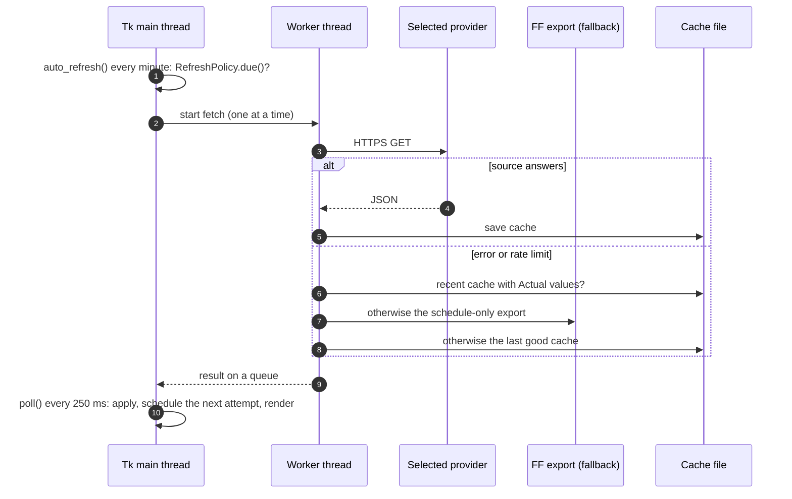

# Architecture

EconPulse is a single-process Tkinter app with no server. This page explains how the pieces fit together, so you can find your way around before changing something.

## Modules

| Module | Responsibility |
|---|---|
| `__init__.py` | Version, app name and repository: the single source for the UI, the network User-Agent, the build and the release check |
| `app.py` | The `EconPulse` class: application state, the refresh cycle, the per-second tick, alerts, toasts and the tray icon. Window code lives in three mixins (`CalendarWindowMixin`, `WidgetWindowMixin`, `DialogsMixin`) so each file stays readable |
| `history.py` | The local record of past releases (`history.json`), written by the fetch thread after each download and read by the details window |
| `refresh.py` | `RefreshPolicy`: when to fetch. The polling interval, backoff, Retry-After, the 2-minute manual gap, supersede on a provider switch and the opt-in post-release check, all with the clock passed in (no Tk) |
| `state.py` | App state helpers with no Tk dependency, so they're easy to test: watched currencies, "Result published" detection, the opt-in post-release checks, per-indicator notes and the optional `next.json` status file |
| `core.py` | The immutable `Event` dataclass, provider-neutral parsing and validation, and `AlertEngine` (each alert fires once, across restarts, including starred releases) |
| `feed.py` | Picks the source, falls back, and reads and writes the on-disk cache |
| `providers/` | One module per data source behind a small `Provider` interface. `base.http_get_json` is the only network code: HTTPS only, size-capped, honest User-Agent, typed errors for rate limits and rejected keys |
| `event_list.py` | `EventCanvas`, a virtualised list that draws only the visible rows and retains drawing between ticks, and `NextUp`, the countdown hero |
| `controls.py` | Custom-drawn widgets: anti-aliased rounded buttons, segmented controls, toggles, selects, scrollbars, tooltips |
| `theme.py` | Dark and light palettes, font selection, HiDPI scaling (`px()`), icon glyphs and the brand mark |
| `i18n.py`, `locales/` | String lookup, per-language hooks (digits, plurals, calendars) and right-to-left layout mirroring |
| `storage.py` | The per-user data folder and settings, validated against a schema on every load |
| `system.py` | Everything OS-specific: DPI, native title bars, work areas, docking the compact bar (`AppBar`), the global shortcut, single instance, start at login (Windows, Linux and macOS), sounds, secrets, safe link opening |
| `exports.py` | CSV (formula-injection safe) and RFC 5545 ICS export |
| `updates.py` | The optional once-a-day GitHub release check, and installing an update: download, checksum and attestation checks, then the Setup.exe |

## A refresh, step by step

Rules that keep this safe and polite:

- **Tk is single-threaded.** Tk objects are created, used and freed only on the main thread. Worker threads (the calendar fetch, biquote's parallel requests, the update check and download, the global-shortcut listener) exchange plain data or callables with it through `io_queue` and `ui_queue`, which the main thread polls. Even *freeing* a Tk object on another thread can abort the process (see `tests/helpers.collect_tk_garbage`).
- **Polling is polite.** At most every 15 minutes, backing off to 30, 60 and 120 minutes after failures and honouring `Retry-After`. Fallback answers count as failures, so a broken source isn't hammered.
- **The one exception is opt-in.** With *Fast check after high-impact releases* on, the app refreshes once 45 seconds and once 3 minutes after each watched release *time* that is still missing its Actual figure: two extra refreshes per busy minute, however many releases share it. It never runs while the source is failing or backing off, or on a schedule-only source (`state.due_burst_poll`).
- **Only what changes is downloaded.** biquote covers ten days back to ten ahead in three weekly requests. Between hourly full downloads, only yesterday to tomorrow is fetched again (one request) and merged with the rest.
- **The screen is never empty if anything was ever loaded:** fresh data, then the fallback, then the cache.

## Drawing and performance

- **Lists are virtualised.** `EventCanvas` lays out rows once and draws only the ones in view, so hundreds of events scroll smoothly.
- **The per-second tick changes text, not layout.** Countdowns and the "now" line update existing canvas items. A full redraw happens only when the data, the day or the next-release marker changes (see `tests/test_refresh.py`).
- **Hidden windows skip cosmetic work.** Alerts are checked every second regardless.
- **Startup takes about a quarter of a second** for the packaged app on a typical laptop. `tests/test_refresh.py` guards startup time and simulates a full day of ticks and refreshes to check that drawing and caches stay flat.
- **Text size is a zoom.** `theme.set_text_size()` scales fonts *and* `px()` together, so larger text never overflows a fixed-size row.

## Right-to-left layout

Each screen is written once, left to right. While an RTL language is active, `i18n.install_rtl_geometry()` makes the Tk packer mirror `side`, `anchor` and padding, the way Qt's layout direction works. Canvas-drawn widgets use `controls.Mirror` to flip x coordinates. Mixed Persian and Latin text is drawn as separate items where bidi ordering would otherwise go wrong.

## Testing

`python -m unittest discover -s tests` runs everything, with no network and no real settings:

- Providers are tested against invented payloads in each source's real field shape.
- UI tests open every window in demo mode with the data folder redirected to a temporary directory (`tests/test_ui.py`).
- Static checks guard translation coverage and hidden bidirectional characters ("Trojan Source").
- The parsers for downloaded data are fuzzed: `fuzz/fuzz_calendar_data.py` turns random bytes into hostile provider payloads and checks that nothing crashes, text stays length-capped, every event renders in every time zone, and exports stay safe. It runs coverage-guided with Atheris in CI, and as a quick deterministic test locally (`tests/test_fuzz.py`).

- Property-based tests (`tests/test_properties.py`, [Hypothesis](https://hypothesis.readthedocs.io/)) check rules that must hold for any input: ids never merge, no alert fires twice, a settings file of any shape loads to a valid configuration. They run where the dev tools are installed.
- `python -m mypy` type-checks the package: strictly for the pure modules, while the UI mixins wait for their shared state to move into one object.

CI runs the tests on Windows, macOS and Linux, and enforces the coverage floor set in `pyproject.toml`. One Windows job runs them in a random order and fails on leaked files or sockets (`tools/run_tests.py`; the seed is in the log). The *Visual check* workflow renders the key screens at a fixed moment and compares them with the reference images in `tests/visual/`. Once a month, mutation testing (`mutmut`, configured in `pyproject.toml`) plants small bugs in the pure logic and checks that the tests catch them. A daily workflow (`tools/canary.py`) checks that the live data sources still return the fields and date ranges the app expects.

## Adding things

- A data source: [PROVIDERS.md](PROVIDERS.md)
- A language: [TRANSLATING.md](TRANSLATING.md)
- Anything else: [CONTRIBUTING.md](../CONTRIBUTING.md)
